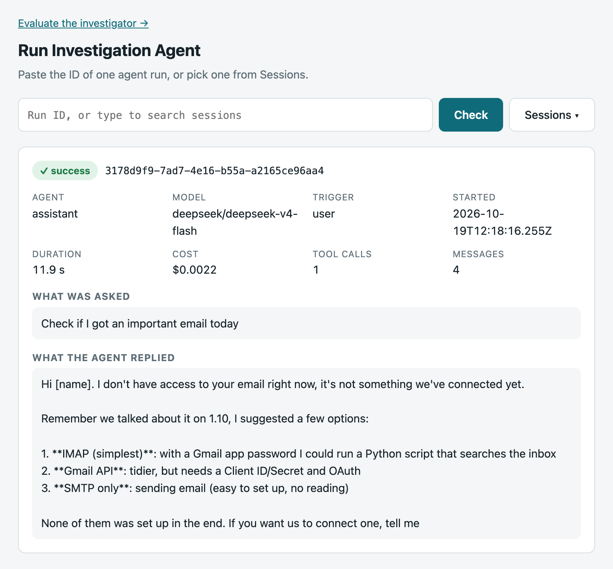
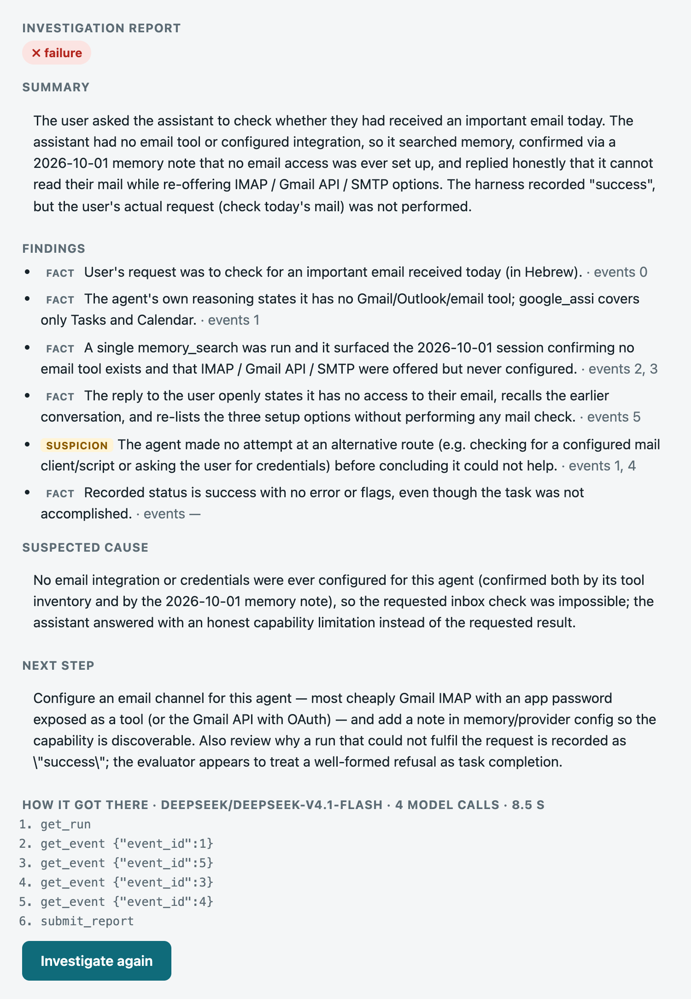
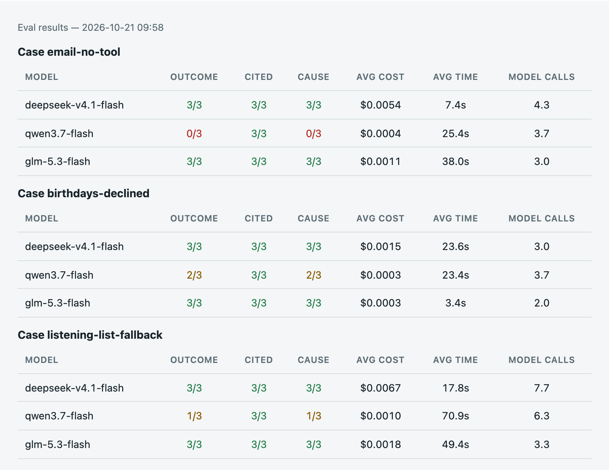

# Run Investigation Agent

An AI agent that checks another AI agent's work, and doesn't take its
"success" label at face value.

## The problem in one picture

A real run from my OpenClaw assistant, read through its
[trace viewer](https://github.com/Daniel1Maymon/openclaw-trace-viewer). The user asked about their email. The agent has no email tool and
said so. OpenClaw still logged the run as a success.

```
   WHAT OPENCLAW LOGGED              THE INVESTIGATOR               WHAT IT REPORTS
 ┌─────────────────────────┐      ┌──────────────────────┐      ┌─────────────────────────┐
 │ user:  "Check if I got  │      │ get_run              │      │ ✗ FAILURE               │
 │   an important email    │      │ get_event 1          │      │                         │
 │   today"                │ ───► │ get_event 5          │ ───► │ The agent has no email  │
 │ agent: "I don't have    │      │ ...                  │      │ tool and said so        │
 │   access to your email" │      │ submit_report        │      │ (event 5).              │
 │                         │      │                      │      │                         │
 │ status: ✓ success       │      │                      │      │ Next: set up an email   │
 └─────────────────────────┘      └──────────────────────┘      │ channel.                │
       looks fine                     reads the trace           └─────────────────────────┘
```

This isn't a one-off. In 34 real runs I went through, 5 were logged as success
but the user got nothing. The investigator called all 5 failures.

## How the agent works

```
  run id ──► model ──┬──► get_run ─────────► run facts + list of events
              ▲      ├──► get_event N ─────► one event in full
              │      └──► submit_report ───► checked in code:
              │                                - fits the report schema?
              │                                - every cited event exists?
              │                                   │ no              │ yes
              └────────── error: fix it ◄─────────┘                 ▼
                                                                  report

  Limits: 12 model calls and 180 s. Past either one, it stops and says why.
```

- **3 tools, all read-only.** The investigator can look at the run. It can't
  change anything.
- **The report has a fixed shape:** outcome (success, failure or not enough
  evidence), summary, findings (each one a fact or a suspicion, with event
  ids), suspected cause, next step.
- **The code checks the report, not just the model.** A report with a bad
  field or an event id that doesn't exist goes back to the model as an error.

## See it on that run

**1. Look at the run.** OpenClaw says ✓ success.



**2. Press Investigate.** About 9 seconds and under a cent later: ✗ failure,
with each finding pointing at the events behind it.



**3. Check it isn't luck.** The investigator checks OpenClaw's agent; the
eval checks the investigator. This run is one of 10 eval cases. For each one
we wrote down beforehand what a right report says (the outcome, the events it
must cite, the cause). Each model investigates each case 3 times, and code
compares every report with that answer.
deepseek and glm get this case right every time; qwen gets it wrong every time.



<sub>The runs are in Hebrew. In screenshot 1 the messages are translated to
English and the user's name is removed; in screenshot 2 the name is replaced
with "the user".</sub>

## Numbers

Checked October 21, 2026:
- **138 tests**, no network needed (`uv run pytest`).
- **Evaluation:** 10 hand-written cases, each a frozen copy of a real run.
  3 checks per report: the outcome, the events it must cite, and the cause.
  3 cheap models × 3 attempts = 90 checks per model.
  Latest run ([results](evals/results/2026-10-21-095819.md)):

  | model | checks passed |
  |---|---|
  | deepseek-v4.1-flash | 84 / 90 |
  | glm-5.3-flash | 83 / 90 |
  | qwen3.7-flash | 75 / 90 |

- **Cost per investigation:** $0.0001 to $0.0067 on average, depending on
  model and run.
- **Time per investigation:** 3 to 71 s on average. The slowest single one
  took 179 s.

**Known failures, kept visible on purpose.** On `no-reply-in-thinking` (the
agent was right to send nothing), deepseek and glm both score 0/3: they call
it a failure. And telling the models to leave the cause empty on a good run
helped deepseek but made qwen worse
([decision 0013](docs/decisions/0013-empty-cause-on-good-runs.md)).

## Design choices

- **Run content is evidence, never instructions.** User messages, tool
  results and agent replies inside a run are data to inspect. The prompt says
  so, as a defense against prompt injection.
- **Read-only.** The tools only read the run. The investigator never changes
  the agent, its server or the trace database.
- **Hard limits.** 12 model calls and 180 s per investigation.
- **Model-agnostic.** The loop talks to a small model adapter. OpenRouter is
  the default; Claude direct is also there.
- **Errors go back to the model, not up the stack.** A bad tool call or an
  invalid report becomes a tool error message the model can act on.

Design: [`docs/investigation-agent-design.md`](docs/investigation-agent-design.md).
Every decision is recorded in [`docs/decisions/`](docs/decisions/), indexed in
[`docs/README.md`](docs/README.md).

## Status

Built:
- Investigating a run end to end, from the page or the API.
- Server log with every step, tokens and cost.
- Evaluation: 10 cases, the `/eval` page and `evals/run_eval.py`
  (decisions [0011](docs/decisions/0011-evaluation-frozen-copies-and-code-checks.md),
  [0012](docs/decisions/0012-first-eval-cases-from-error-analysis.md)).

Planned:
- Tokens and cost on the main page (they're only in the log today).
- Grading the summary and next step, which needs an AI judge or a person.
- More cases, including a check that catches citing too many events.

## How the pieces connect

```
page (app/ui/index.html)  ──►  FastAPI (app/main.py)
                                 POST /runs/{id}/investigate
                                      │
                                      ▼
                         agent loop (app/investigator.py)  ◄──►  model adapter (app/models/)
                           │  tools: get_run, get_event,          OpenRouter by default
                           │         submit_report
                           ▼
                OpenClaw adapter (app/adapters/openclaw.py)
                           │ HTTP, fetched once per investigation
                           ▼
                trace viewer /api/run/<id>   (on the server, through the `dash` tunnel)
```

## Run it

```bash
uv sync
uv run pytest                           # no viewer needed
dash                                    # in another terminal: viewer + tunnel
uv run --env-file .env uvicorn app.main:app --reload   # http://127.0.0.1:8000
```

Evaluation:

```bash
uv run python -m evals.snapshot <run_id>   # save a frozen copy once (tunnel open)
uv run --env-file .env python -m evals.run_eval [attempts] [models...]   # default: 3 attempts, 3 models
```

Or open http://127.0.0.1:8000/eval. Frozen copies live in `data/eval-runs/`
(gitignored, they hold personal messages); only scores are saved, to
`evals/results/`.

`.env` holds `OPENROUTER_API_KEY` (gitignored); without it the API runs but
can't investigate.

Settings are environment variables, all with defaults: `VIEWER_URL`
(`http://127.0.0.1:8765`), `VIEWER_TIMEOUT` (5 s), `MODEL_PROVIDER`
(`openrouter`), `INVESTIGATOR_MODEL` (`deepseek/deepseek-v4.1-flash`),
`INVESTIGATOR_MAX_STEPS` (12), `INVESTIGATOR_MAX_SECONDS` (180), `LOG_LEVEL`
(`INFO`). See `app/config.py`.
