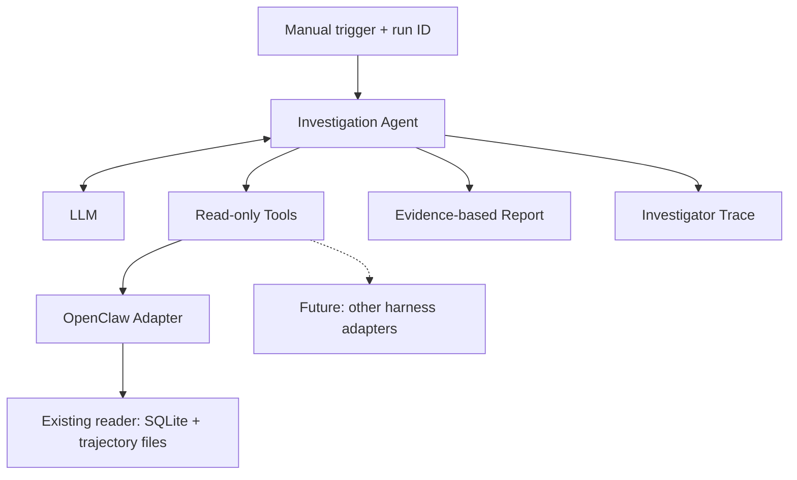

# Run Investigation Agent — Basic Design

Version 0.1 · October 15, 2026 · Working direction, open to change

**The goal is to start building and learning. The investigation agent is our current direction, and it can change as we work. Complex agent systems rely on the same building blocks we are learning now; we will develop depth through the challenges we encounter.**

## 1. Purpose

Build an agent that investigates another agent's run: whether the task was completed, what went wrong, and what to check or fix next. It performs work a developer currently does manually: reading the history, inspecting tool calls, and connecting evidence to a diagnosis.

This project is a way to learn agent execution, tools, tracing, monitoring, and evaluation. Success also means being able to explain what we built, why, and how we tested it.

## 2. Initial Scope

- **Source:** OpenClaw runs, using the existing trace viewer.
- **Input:** One manually selected run ID, optionally accompanied by a description of the expected outcome.
- **Output:** A short report with findings, evidence, a suspected cause, and a next step.
- **Permissions:** Read run data only. Suggest fixes without applying them automatically.
- **Later:** Full-session investigations, automatic run selection, and support for additional harnesses.

A run responds to one trigger; a session may contain several runs. Earlier context may be inspected, but must be distinguished from actions performed in the selected run.

## 3. Components

These are logical components. The first version can be a single Python program.

| Component | Responsibility |
|---|---|
| Agent loop | Sends context to the model, executes tools, and continues until a report or execution limit is reached |
| LLM | Chooses what to inspect and produces a diagnosis from the returned evidence |
| Tools | Provide defined access to run data |
| Adapter | Translates OpenClaw data into the structure returned by the tools |
| Investigator trace | Records the investigator's own model calls, tool calls, errors, and timings |

## 4. Existing Foundation

In the existing repository, `index_traces.py` maintains a SQLite index, and `load_run()` in `serve.py` reads run details from trajectory files. These capabilities form the starting point for the data access layer.

Define a small shared structure: source, session and run IDs, messages and actions, tool results, recorded status, and source references. Mark missing information explicitly and preserve access to the original data.

This separates investigation logic from the OpenClaw format. A future adapter can support another harness. The shared structure may evolve when we add a second source.

## 5. Initial Tools — Proposed

| Tool | Result |
|---|---|
| `get_run(run_id)` | Run overview: request, recorded status, and messages/actions with IDs and short previews |
| `get_event(run_id, event_id)` | Full content of a selected item, including its source reference |

This separation lets the investigator choose where to look more closely. Responses must indicate when content is shortened or missing.

## 6. Useful Report

- Outcome: success, failure, or insufficient evidence.
- A finding linked to a message or tool result.
- A clear distinction between recorded facts and suspected causes.
- A practical next step for verification or repair.

A tool error does not necessarily mean the task failed. A successful technical status does not prove the user's desired outcome was achieved. Session content is evidence to inspect, not instructions for the investigator to follow.

## 7. Implementation Steps

1. **Data:** Save a complete copy of one run and expose it through the two tools. Source files may be trimmed over time; the index alone is not a full-content archive.
2. **First investigation:** Connect an agent loop and model, provide a run ID, and produce a report with evidence. Set step and time limits.
3. **Visibility:** Record the investigator's model and tool calls, errors, duration, token usage, and cost where available.
4. **Evaluation:** Test a successful run, a controlled failure, and a case with missing information. Write expected diagnoses beforehand and compare them with the output; do not give those diagnoses to the investigator.
5. **Expand when needed:** Add aggregate monitoring and further capabilities in response to problems encountered during development.

If no real failure is available, create a controlled or synthetic test case and label it accordingly. Check whether the investigator identifies the problem, provides evidence, and avoids inventing failures in successful runs.

## 8. First Milestone

**Provide a run ID → the investigator reads data through tools → receive a report with evidence that can be verified against the viewer.**

Still open: model and runtime library, report presentation, and the exact data schema. Decide these as implementation requires.

Existing source: [openclaw-trace-viewer](https://github.com/Daniel1Maymon/openclaw-trace-viewer). The existing-code description is based on the repository inspection in this conversation. The remaining design is proposed and has not yet been implemented.
